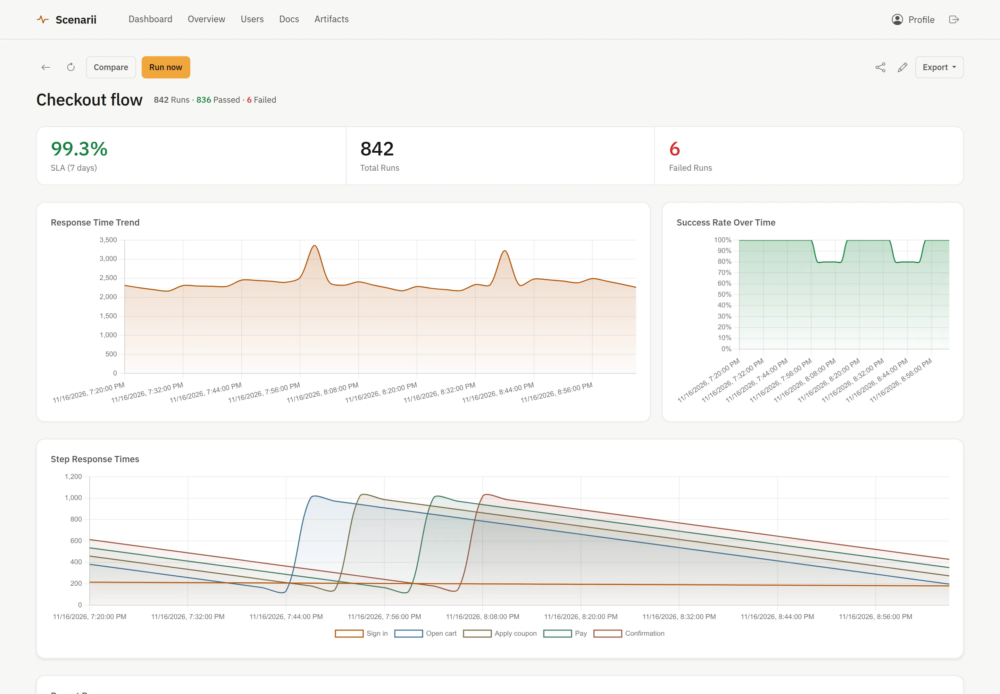
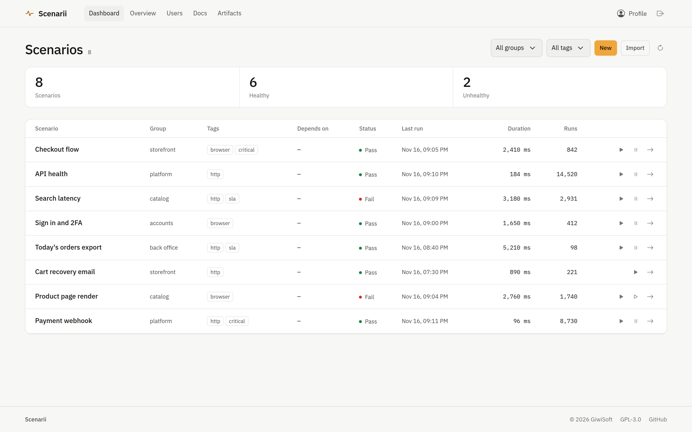
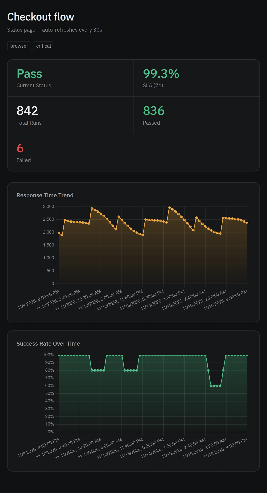

<p align="center">
  <picture>
    <source media="(prefers-color-scheme: dark)" srcset="docs/logo-dark.svg">
    
  </picture>
</p>

<p align="center">
  Self-hosted HTTP and browser checks from YAML, on a cron, with pass rates, step timings and alerts.
</p>

<p align="center">
  <a href="https://github.com/GiwiSoft/scenarii/wiki">Documentation</a> ·
  <a href="https://github.com/GiwiSoft/scenarii/wiki/API">REST API</a> ·
  <a href="https://github.com/GiwiSoft/scenarii/wiki/Deployment">Deployment</a>
</p>

<p align="center">
  <picture>
    <source media="(prefers-color-scheme: dark)" srcset="docs/screenshots/scenario-detail-dark.webp">
    
  </picture>
</p>

<p align="center"><sub>Scenario detail: SLA, response time, success rate and every step timing.</sub></p>

## What it does

- **HTTP and browser checks** in one YAML scenario, using native `fetch` or Lightpanda.
- **Cron, time windows, dependencies, API runs** and GitHub/GitLab webhook triggers.
- **Pass-rate calendar, p95 latency, flaky ranking**, run diffs and screenshots.
- **Alerts** on Telegram, Slack, Discord, Teams, email, ntfy, PagerDuty and signed webhooks.
- **SQLite or PostgreSQL**, with retention and scheduled backups.
- **Dashboard, REST API**, scoped API tokens, OIDC and TOTP.

## Screenshots

<p align="center">
  <picture>
    <source media="(prefers-color-scheme: dark)" srcset="docs/screenshots/scenario-list-dark.webp">
    
  </picture>
</p>

<p align="center"><sub>The scenario list follows the light or dark theme.</sub></p>

<p align="center">
  
</p>

<p align="center"><sub>A public status page, no sign-in required.</sub></p>

## Quick start

Requirements: **Node.js 26+**.

```bash
npm install
npm run build
node dist/index.js server
```

Open <http://localhost:3000>. On first start Scenarii creates an `admin` user and prints a generated password to the logs.

Run a scenario without the dashboard:

```bash
node dist/index.js trigger scenarios/lusk.yml --fail-on none
```

## Minimal scenario

```yaml
name: Smoke
base_url: https://example.com
schedule: "*/5 * * * *"

steps:
  - name: Homepage
    action: http.get
    url: /
    expect:
      status: 200
      body_contains: Example Domain
```

```bash
node dist/index.js validate scenarios/smoke.yml
node dist/index.js trigger scenarios/smoke.yml --env staging
```

## CLI

| Command | Purpose |
|---------|---------|
| `server` | API, dashboard, scheduler, WebSocket |
| `validate [file]` | Validate YAML, schema, cron, required fields (`--all`, `--json`) |
| `trigger <file>` | Run immediately (`--fail-on none`, `--env staging`, `--db ...`) |
| `status` | Scheduled scenarios and storage status |
| `user <action>` | Manage users (`list`, `add`, `passwd`, `role`, `del`) |
| `config` | Generate a settings template (`-o path`) |

Server options and automation examples are in the [CLI documentation](https://github.com/GiwiSoft/scenarii/wiki/CLI).

## Docker

```bash
docker build -f Containerfile -t scenarii .
docker run -d --name scenarii -p 3000:3000 \
  -v "$PWD/scenarios:/app/scenarios" \
  -v "$PWD/db:/app/db" \
  -v "$PWD/data:/app/data" \
  scenarii
```

Compose, PostgreSQL, reverse proxy and systemd examples: [Deployment](https://github.com/GiwiSoft/scenarii/wiki/Deployment).

## Documentation

The full documentation lives in the [GitHub wiki](https://github.com/GiwiSoft/scenarii/wiki).

| Topic | Page |
|-------|------|
| Installation and first run | [Installation](https://github.com/GiwiSoft/scenarii/wiki/Installation) |
| First scenario walkthrough | [Getting Started](https://github.com/GiwiSoft/scenarii/wiki/Getting-Started) |
| Scenario YAML, includes, conditions | [Scenarios](https://github.com/GiwiSoft/scenarii/wiki/Scenarios) |
| HTTP and browser actions | [Actions](https://github.com/GiwiSoft/scenarii/wiki/Actions) |
| Variables, secrets, extraction | [Variables and Secrets](https://github.com/GiwiSoft/scenarii/wiki/Variables-and-Secrets) |
| Staging and production profiles | [Environments](https://github.com/GiwiSoft/scenarii/wiki/Environments) |
| Cron, pause/resume, alert thresholds | [Scheduling](https://github.com/GiwiSoft/scenarii/wiki/Scheduling) |
| Alert channels and webhook signing | [Notifications](https://github.com/GiwiSoft/scenarii/wiki/Notifications) |
| GitHub/GitLab CI triggers | [Inbound Webhooks](https://github.com/GiwiSoft/scenarii/wiki/Webhooks) |
| Endpoint reference and examples | [REST API](https://github.com/GiwiSoft/scenarii/wiki/API) |
| Pages, overview, run diff | [Dashboard](https://github.com/GiwiSoft/scenarii/wiki/Dashboard) |
| Local users, OIDC, TOTP, tokens | [Authentication](https://github.com/GiwiSoft/scenarii/wiki/Authentication) |
| SQLite/PostgreSQL, backups | [Storage](https://github.com/GiwiSoft/scenarii/wiki/Storage) |
| Full `settings.yml` reference | [Configuration](https://github.com/GiwiSoft/scenarii/wiki/Configuration) |
| Troubleshooting | [Troubleshooting](https://github.com/GiwiSoft/scenarii/wiki/Troubleshooting) |

## Development

```bash
npm run dev        # API + Angular HMR
npm test           # backend build + all tests
npm run lint       # tsc --noEmit
```

Project layout and extension guides: [Development](https://github.com/GiwiSoft/scenarii/wiki/Development).

## Security

Report vulnerabilities privately through [GitHub Security Advisories](https://github.com/GiwiSoft/scenarii/security/advisories/new) or `security@giwi.fr`. Do not open a public issue.

[`SECURITY.md`](SECURITY.md) defines scope, supported versions, response targets and coordinated disclosure. CI publishes a CycloneDX SBOM with each release, and Dependabot alerts are enabled.

## License

GPL-3.0. See [LICENSE](LICENSE).
